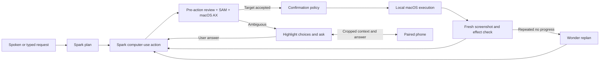

# Architecture

AVO is an interaction layer around a computer-use loop. It keeps task execution on the Mac and uses Meta models for speech, planning, action proposals, segmentation and review.

## Boundaries

`avo/agent.py` orchestrates planning, execution and interruption. `confidence.py` asks a separate Spark call to review planned targets. `gate.py` combines ambiguity, accessibility and SAM evidence. A precise click is not necessarily the right choice; accessibility cannot resolve user intent. If review fails, the gate asks rather than treating target precision as sufficient evidence.

`confirm.py` separately classifies detected irreversible actions from control names, key combinations and the review. Routine actions show a target countdown; detected irreversible actions require a preview and yes. This is heuristic detection, not a universal safety guarantee.

`driver.py` and `events.py` execute tagged macOS input events and check target freshness. `human.py` distinguishes human takeover and pauses. `effect.py` compares screen changes and catches repeated ineffective actions; Wonder receives the task history to propose a fresh plan. The system stops when its limits are exhausted.

`overlay/main.js` hosts the Electron UI and launches the agent. `overlay/voice.js` streams Mac microphone input to Meta realtime ASR. Visible accessibility labels and current candidates provide recognition keywords. `overlay/remote.js` serves the phone UI on a private-network interface: one-time pairing code, one active phone, expiring session token, bounded messages and an allowed command list. Remote is disabled by default and uses unencrypted LAN transport. The phone keyboard may provide dictation through the phone OS.

## Performance choices

The action loop sends the current screenshot and textual action history rather than resending all previous screenshots. Review and per-target segmentation run concurrently. Accessibility-based snapping avoids a model call for a clear near-miss. A small screenshot crop supplies detail for review; the phone receives only the region associated with the question. None of these remove the ambiguity review or explicit approval for detected irreversible actions.

## Data and cost

Screenshots and task text leave the Mac for Meta inference; microphone audio is sent during Mac speech recognition. Local run directories contain screenshots, task text, answers and model responses and are git-ignored. They may contain sensitive information: do not publish a run directory without review. Evaluation exports include fictional tasks only. The paired phone receives task status and question context over the LAN.

`meter.py` logs Responses calls and estimated cost by purpose. It does not meter realtime ASR and does not implement a provider-side hard spending cap. Client-side task limits cannot safely substitute for server-side quotas on a shared hosted service.

## Scope

No remote shell, hosted desktop, public relay or distributed API key is included. General desktop reliability and testing with intended users remain future work.
