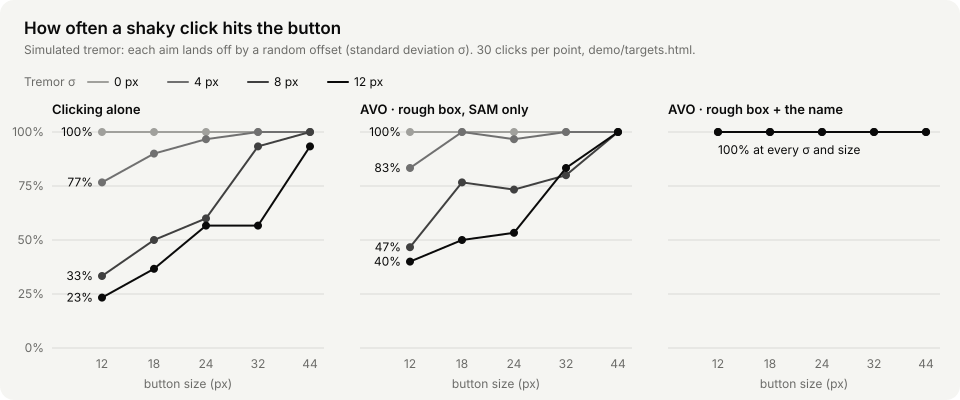

# AVO evaluation

Real measurements only. Anything not yet measured says so. Every number here comes from a file in this repo or from a run log, named next to it.

## How tuning and reporting are kept apart

AVO's thresholds were tuned on one set of tasks, and results are reported on others it never saw while tuning.

**Used for tuning (development):**
- The 10/28 baseline: 10 tasks in `eval/tasks.json`, with 39 clicking steps labelled right or wrong by hand (`runs/baseline-20261028-232423/labels.json`, not in the repo). The gate's rule and its SAM threshold (`SAM_CLEAR = 0.8`) come from these.
- The live runs of 10/29–10/31 on the board, expense and moving demo pages and on metacareers.com. The answers given to AVO's questions in those runs were used to check the gate rule, so they are development data too.

**Used only for reporting:**
- **E2** (simulated tremor, `demo/targets.html`). The parameters were fixed before the one and only run, and nothing was changed after seeing the results.
- **The demo tasks** (`eval/demos.json`: mail, room, course). These were built after the gate's thresholds were set, and no threshold was changed after their runs. One task wording did change after a run: room's "this Friday" became "next Friday", because nobody reads "this Friday" (said on a Saturday) as ambiguous. That changes what the task tests, not how AVO decides.
- **E1** tasks 6–8 are new; tasks 1–5 use the demo pages AVO was tuned on, and are reported apart.

## E2 · Simulated tremor: clicking alone vs AVO

`node scripts/e2_capture.mjs`, then `uv run scripts/run_e2.py`. Results are in `eval/e2/results.json`; the chart is `docs/images/e2-tremor.svg`.

Each aim lands off by a Gaussian offset with standard deviation σ on each axis. There are 30 clicks per cell, on one 1280×800 screenshot of `demo/targets.html`: five rows of eight buttons, 4 px apart, with the same eight names in every row. That was 600 SAM 3.1 calls, $1.50, median SAM time 0.44 s.

- **Alone:** the click lands at the button's centre plus the offset. This is computed, not clicked.
- **AVO, SAM only:** a rough box MARGIN = 8 px beyond the button, each corner off by the offset. SAM 3.1 segments it, and AVO clicks the middle of the mask.
- **AVO, SAM + name:** the user also says the button's name. AVO takes the button of that name within 16 px of the box, using the page's own boxes, which is what macOS accessibility reports for Chrome. If no such button exists, it uses the SAM-only click.

| Button | Tremor σ | Alone | AVO, SAM only | AVO, SAM + name |
|---|---|---|---|---|
| 12 px | 4 px | 77% | 83% | 100% |
| 12 px | 8 px | 33% | 47% | 100% |
| 12 px | 12 px | 23% | 40% | 100% |
| 18 px | 4 px | 90% | 100% | 100% |
| 18 px | 8 px | 50% | 77% | 100% |
| 18 px | 12 px | 37% | 50% | 100% |
| 24 px | 4 px | 97% | 97% | 100% |
| 24 px | 8 px | 60% | 73% | 100% |
| 24 px | 12 px | 57% | 53% | 100% |
| 32 px | 4 px | 100% | 100% | 100% |
| 32 px | 8 px | 93% | 80% | 100% |
| 32 px | 12 px | 57% | 83% | 100% |
| 44 px | 4 px | 100% | 100% | 100% |
| 44 px | 8 px | 100% | 100% | 100% |
| 44 px | 12 px | 93% | 100% | 100% |

At σ = 0 every group hits 100%.

**Read with care:**
- The 100% for "SAM + name" assumes the app exposes its buttons' names and that AVO heard the name right. The rows on the test page sit further apart than in most apps.
- SAM alone sometimes does worse than clicking alone, for example a 32 px button at σ 8 px: 93% → 80%.
- The time a click takes is not modelled.

## Demo tasks · first scripted run

`uv run scripts/run_demo.py` serves the demo pages, checks each run against `eval/demos.json` from what the page reports, and uses a script to answer for the user (`avo/scripted.py`). These are single runs, so they only show that the tasks work; they are not a success rate.

| Task | Done right | Things said | Steps | Time | Cost |
|---|---|---|---|---|---|
| mail-smith | yes | 3 | 5 | 46 s | $0.049 |
| room-friday | yes | 3 | 5 | 49 s | $0.050 |
| course-week3 | yes | 2 | 2 | 22 s | $0.018 |

The room run above used the old wording, "this Friday"; it must be re-run with "next Friday".

## E1 · What it takes: Voice Control vs AVO

*Set up on 11/01, not run yet.* The method below was written before any data, and won't change to suit the results.

**Tasks** (`eval/e1/tasks.json`, 8 for now; more if there's time). Tasks 1–5 run on the demo pages AVO was built and tuned on (other tasks on them shaped its prompts and checks), which favours AVO; tasks 6–8 are new to it. Results are reported for both groups separately.

| # | Task | Where | Checked by |
|---|---|---|---|
| 1 | Reply to Professor David Smith's lab email, say you'll be ten minutes late, send it | mock (`demo/mail.html`) | the page: sent to David |
| 2 | Book a study room on Friday, November 13 at 2 pm | mock (`demo/room.html`) | the page: booking |
| 3 | Download the corrected week 3 handout | mock (`demo/course.html`) | the page: which file |
| 4 | Fill in the expense form from the receipt (follow the policy) and submit | mock (`demo/expense.html`) | the page: Lakeview · 2026-10-24 · Meals · $46.54 |
| 5 | Assign the "Update Q4 budget sheet" card to Alex Rivera | mock (`demo/board.html`) | the page: owner |
| 6 | On Wikipedia, find the year the Golden Gate Bridge opened | real site | the answer (1937) |
| 7 | On Meta Careers, search for software engineer internships | real site | the person: results showing |
| 8 | Move e1-notes.txt on the Desktop into the e1-archive folder | real app (Finder, made-up file) | the disk |

The tasks name exactly what is meant (David, Rivera, the corrected handout), so neither tool has to resolve an ambiguity: E1 measures effort, E3 measures ambiguity.

**How.** `uv run scripts/e1.py` serves a timer page. Each task is done twice, once with macOS Voice Control and once with AVO, by speaking only. Tasks 1–4 go Voice Control first, 5–8 AVO first, so that having seen a task once helps each tool equally. Voice Control is off during AVO tasks and AVO is idle during Voice Control tasks.

**Measures.**
- **Done:** checked by the page, the disk, or the answer; for task 7, by the person. Giving up counts as not done.
- **Time:** from Start to the page's own report (the send, the booking, the file arriving) when there is one, otherwise to the Done click.
- **Things said:** the microphone records while a task runs, and Meta's speech recognition (endpointing) counts the utterances afterwards (`scripts/e1.py --count`), the same way for both tools. Voice Control keeps no log of its own. The audio stays on the Mac (`eval/e1/audio/`, not committed).
- **Mistakes:** steps the person had to undo or redo, reported by the person after each task.
- **Cost:** AVO's API spend, from its `summary.json`.

**Limits, stated up front.** One person, the author, who has no motor impairment and used Voice Control for the first time. That gives a first impression of the effort, not a user study. Utterance counts from endpointing are approximate (a command said with a pause can count twice).

## E3 · Silent errors: does asking prevent confidently wrong results?

`uv run scripts/run_demo.py --modes full,irreversible,bare --runs 3`, run on 11/01 (results in `runs/demo-20261101-014421/results.json`, not in the repo). It covers the three demo tasks, each with a real ambiguity, 3 runs per setup. A script plays the user and answers what AVO asks the way the task spec says the user means it (`avo/scripted.py`). A **silent error** is a run that ends with the wrong result (sent to the wrong professor, booked the wrong Friday, downloaded the wrong handout) and reports it as done, without having asked the user anything.

| Setup | Mail (two Smiths) | Room (next Friday) | Course (two handouts) | Done right | Wrong without asking | Things said (median) | Cost per run |
|---|---|---|---|---|---|---|---|
| AVO as shipped | 3/3 right, 0 silent | 3/3 right, 0 silent | 3/3 right, 0 silent | 9/9 | **0/9** | 2 | $0.041 |
| asks only before irreversible steps | 0/3 right, 3 silent | 0/3 right, 2 silent | 3/3 right, 0 silent | 3/9 | **5/9** | 2 | $0.025 |
| the agent alone | 0/3 right, 3 silent | 0/3 right, 2 silent | 1/3 right, 2 silent | 1/9 | **7/9** | 1 | $0.027 |

The three setups:
- **AVO as shipped:** the gate (which-one questions, location checks) and every confirmation.
- **Asks only before irreversible steps:** no gate; a yes is needed before send, book and the like, and nothing else.
- **The agent alone:** no gate and no confirmations.

All three still plan first. The planner sometimes asks its own question up front: that is why the course task comes out right without the gate, and why "the agent alone" got one course run right.

**Read with care:**
- 9 runs per setup is small: these numbers show a direction, not a precise rate.
- The tasks were built to contain an ambiguity. On tasks without one, all three setups would do about as well.
- Asking before irreversible steps did not catch the ambiguities. The yes came after the wrong choice had already been made, and the scripted user, like a hurried person, approves a send that looks fine.
- Total cost: $0.83.
